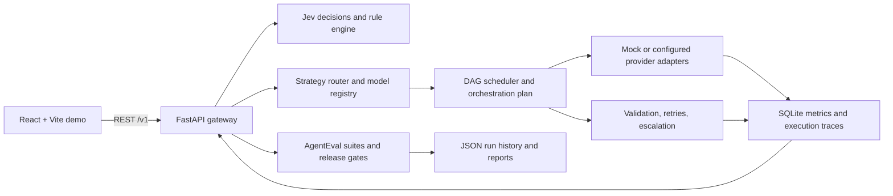

# Enterprise AI Intelligence & ROI Platform

A local-first demo platform for routing AI work to efficient models, coordinating multi-step tasks, capturing execution traces, evaluating agent behavior, and inspecting estimated cost and quality. The repository contains a FastAPI/Python backend and a React/Vite frontend. The standard demo uses deterministic/mock model adapters and does not require paid model credentials.

> **Primary demo:** the React **Simulation** tab runs an end-to-end customer workflow and displays the seven AI capabilities, routing choices, execution nodes, estimated cost/latency, and final output. The seven individual Research Tracks remain available for focused demonstrations.

## What the project includes

- **FastAPI gateway:** accepts requests, applies policy and routing, schedules work, persists metrics, and exposes REST endpoints and interactive API docs.
- **Model registry and adapters:** YAML model catalog with mock-first defaults and optional Ollama, OpenAI, or Anthropic provider integrations where configured.
- **Routing and execution:** rule-based and cost/quality strategies, confidence-based selection, retries, escalation, node validation, concurrent DAG execution, and trace capture.
- **AgentEval harness:** versioned YAML suites, transcript adapters, deterministic checks and optional judges, auditable rationales, release gates, run history, and JSON/HTML reports.
- **Metrics and ROI:** request, provider, latency, cost, retry, escalation, and parallelism summaries backed by SQLite. Cost savings and some quality/precision values are estimates unless measured with a real model and workload.
- **React demo frontend:** configuration and run screens, a seven-capability end-to-end Simulation, research-track explorations, result summaries, and trace inspection.
- **Legacy Streamlit dashboards:** kept in the backend project for existing dashboards; the React frontend is the recommended presentation interface.

## The seven capabilities shown in Simulation

| Capability | How the demo exercises it | What to know |
|---|---|---|
| Jev decisioning | Structured request decisions and configured routing rules run before model work. A matching rule can return without a model call. | The included mock Jev adapter is deterministic. An external Jev service is optional. |
| SLM/LLM routing | Lightweight workflow nodes select a small model tier; higher-quality tasks can use a larger tier. | The demo catalog demonstrates routing. Production SLM/LLM quality must be measured with real models and task data. |
| Edge AI | Privacy policy is passed to the placement router, which checks local model availability and reports placement or fallback. | Actual on-device inference requires an installed/configured local runtime such as Ollama and a compatible model. Without one, the UI reports that no eligible local model was available. |
| Automatic model switching | Confidence-based routing chooses an efficient model or escalates for quality when confidence is below the configured router threshold. | Routing decisions and escalation are visible in the request trace. |
| Task parallelism | Independent DAG worker tasks execute concurrently; dependent synthesis waits for their results. | The trace reports critical-path latency and parallel efficiency. |
| Orchestration agent | A configured hierarchical workflow joins worker outputs in a synthesis step. | The included workflow planner is deterministic; it does not claim autonomous LLM planning. |
| Quantization | Requested precision is attached to model nodes and recorded in the trace. | Mock precision is a request/catalog label. A precision is verified only when the configured provider adapter can confirm the observed model artifact. |

The Simulation screen animates its capability checkpoints for the demo and then sends the workflow to the backend. Observations in the result panel come from the backend trace. A displayed capability can report a fallback or an unverified state when the current machine/runtime does not support the corresponding hardware or artifact.

## Architecture



## Requirements

- Git
- Python 3.10 or newer (Python 3.11 is a good default)
- [`uv`](https://docs.astral.sh/uv/)
- Node.js 20 or newer with npm
- Windows, macOS, or Linux

Docker is optional. Ollama and external provider credentials are optional for the default mock demo.

## Clone and install

The commands below assume PowerShell on Windows. For macOS/Linux, use `cp` instead of `Copy-Item`, and activate/manage tools using the conventions of your shell. Run commands from the repository root unless the command says otherwise.

### 1. Clone the repository

```powershell
git clone https://github.com/Viraj-1124/Enterprise-AI-intelligence-ROI.git
cd Enterprise-AI-intelligence-ROI
```

### 2. Prepare Python and the backend

Install `uv` if it is not already installed. On Windows with WinGet:

```powershell
winget install --id astral-sh.uv -e
```

Open a new terminal after installing `uv`, then install the Python project and development dependencies:

```powershell
cd enterprise-ai-platform
Copy-Item .env.example .env
uv sync --extra dev
```

The default `.env.example` uses the mock provider and demo API key. You can run the demo without adding model credentials. Keep the default `API_KEY=demo-key` for a local demo, or configure a private key before sharing the backend.

### 3. Install the React frontend

Open a **second terminal**, navigate to the cloned repository, and run:

```powershell
cd Enterprise-AI-intelligence-ROI\enterprise-ai-platform\frontend
npm ci
```

If the repository was cloned into a differently named folder, replace `Enterprise-AI-intelligence-ROI` with that folder name. `npm ci` uses the committed `package-lock.json` for a reproducible install.

## Start the full application

Keep the backend and frontend running in separate terminals.

### Terminal 1: start the API

From `enterprise-ai-platform/`:

```powershell
uv run uvicorn app.main:app --reload
```

The API listens at `http://127.0.0.1:8000`. Confirm it is ready by opening:

- Health check: <http://127.0.0.1:8000/health>
- Interactive API docs: <http://127.0.0.1:8000/docs>

The health response should be `{"status":"ok"}`.

### Terminal 2: start the React UI

From `enterprise-ai-platform/frontend/`:

```powershell
npm run dev
```

Open <http://localhost:5173>. Vite forwards `/health` and `/v1` calls to the backend at `http://127.0.0.1:8000` by default. The application API key defaults to `demo-key` in the frontend and must match `API_KEY` in the backend `.env`.

### 4. Run a demo

1. Select **Simulation** in the left sidebar.
2. Edit the customer workflow request or keep the sample request.
3. Choose a privacy policy, requested precision, and router confidence.
4. Select **Run full project simulation**.
5. Follow the seven capability checkpoints and review observed decisions, nodes, model/provider selections, placement, latency, cost, final output, and the expandable raw trace.
6. Open **Research Tracks** individually to explore Jev, SLM vs LLM, Edge AI, automatic switching, parallelism, orchestration, or quantization.

The Simulation run requires the API to be connected. Starting the frontend by itself opens the configuration screen but cannot execute a backend simulation.

## Run AgentEval suites

The harness can also be used without the browser, from `enterprise-ai-platform/`:

```powershell
uv run python scripts/agent_eval.py run config/suites/customer_support.yaml --agent-version demo-v1
uv run python scripts/agent_eval.py run config/suites/data_analysis.yaml
uv run python scripts/agent_eval.py run config/suites/policy_compliance.yaml
```

Runs write JSON and HTML reports and append to local run history. The CLI exits with a nonzero status when a configured release gate fails. See [suite format and adapters](enterprise-ai-platform/docs/suite-format.md) for suite authoring and integrations.

## Useful API endpoints

All routes are served from `http://127.0.0.1:8000`:

| Method | Endpoint | Purpose |
|---|---|---|
| `GET` | `/health` | Backend health check |
| `GET` | `/v1/runtime` | Active runtime/provider details |
| `GET` | `/v1/models` | Registered model catalog |
| `POST` | `/v1/request` | Run one request or a DAG (`metadata.subtasks`) |
| `GET` | `/v1/request/{request_id}` | Inspect a saved request/trace |
| `GET` | `/v1/metrics/summary` | Summary metrics and ROI estimates |
| `GET` | `/v1/metrics/timeseries` | Time-series metrics |
| `GET` | `/v1/metrics/provider_truth` | Provider, placement, and precision evidence |
| `GET` | `/v1/agent-eval/suites` | List evaluation suites |
| `POST` | `/v1/agent-eval/run` | Run an AgentEval suite |
| `GET` | `/docs` | Interactive OpenAPI documentation |

Requests that call protected `/v1` endpoints require the `X-API-Key` header. The local demo uses `demo-key` by default.

## Optional: run with local Ollama

Use Ollama when you want model inference on the same machine instead of mock inference. Install Ollama and download a model supported by the project configuration. For example:

```powershell
ollama pull qwen3.5:4b
```

Ensure Ollama is running, then set these values in `enterprise-ai-platform/.env` (use the model ID/tag supported by your installed Ollama version and this project's model registry):

```dotenv
MODEL_PROVIDER=ollama
OLLAMA_BASE_URL=http://localhost:11434
```

Restart the backend after changing `.env`. Check `GET /v1/runtime` and request traces to confirm the selected provider. Local-device placement is only possible for a task/model combination that is actually available through the local runtime. The mock configuration is the easiest option for collaborators to run first.

Optional external providers can be configured with `OPENAI_API_KEY` or `ANTHROPIC_API_KEY`, plus the matching provider selection/model registry settings. Never commit real API keys or `.env` files.

## Optional: legacy Streamlit dashboards

The Streamlit dashboards remain available for the earlier metrics experience. From `enterprise-ai-platform/`:

```powershell
uv run streamlit run app/dashboard/app.py
```

Open <http://localhost:8501>. Use the React UI for the interactive project simulation demo.

## Troubleshooting

### Frontend says the backend is disconnected

- Confirm the API terminal is running and `http://127.0.0.1:8000/health` responds.
- Check that the API uses port `8000`; Vite's default proxy target is configured in `frontend/vite.config.js`.
- If using another API host/port, set `VITE_API_PROXY` before starting Vite (for example `$env:VITE_API_PROXY='http://127.0.0.1:8001'`). Restart Vite after changing it.

### API returns `401 invalid API key`

Make `API_KEY` in `enterprise-ai-platform/.env` match `VITE_API_KEY` in `enterprise-ai-platform/frontend/.env`. If using defaults, keep the backend key `demo-key` and remove any conflicting frontend key. Restart both processes after edits.

### `uv` or `npm` is not recognized

Install `uv` and Node.js/npm, open a fresh terminal, and check `uv --version`, `node --version`, and `npm --version`.

### Ollama request returns an unavailable/runtime error

Start Ollama, verify the model is present with `ollama list`, and confirm `OLLAMA_BASE_URL` is reachable. Switch back to `MODEL_PROVIDER=mock` for the no-credentials demo.

### Frontend dependencies or build are inconsistent

From `enterprise-ai-platform/frontend/`, run `npm ci`. To verify a production bundle, run `npm run build`; to preview it locally, run `npm run preview`.

## Development and project documentation

From `enterprise-ai-platform/`:

```powershell
uv run pytest
uv run ruff check app tests
npm --prefix frontend run build
```

- [Backend runbook](enterprise-ai-platform/RUNBOOK.md)
- [Technical evaluation notes and implementation boundaries](enterprise-ai-platform/docs/technical-evaluations.md)
- [AgentEval suite format](enterprise-ai-platform/docs/suite-format.md)
- [Contributing guide](enterprise-ai-platform/CONTRIBUTING.md)
- [Changelog](enterprise-ai-platform/CHANGELOG.md)

Runtime databases, `.env` files, Python virtual environments, Node dependencies, and frontend build outputs are intentionally ignored by Git. Each collaborator creates these locally by following the setup steps above.
